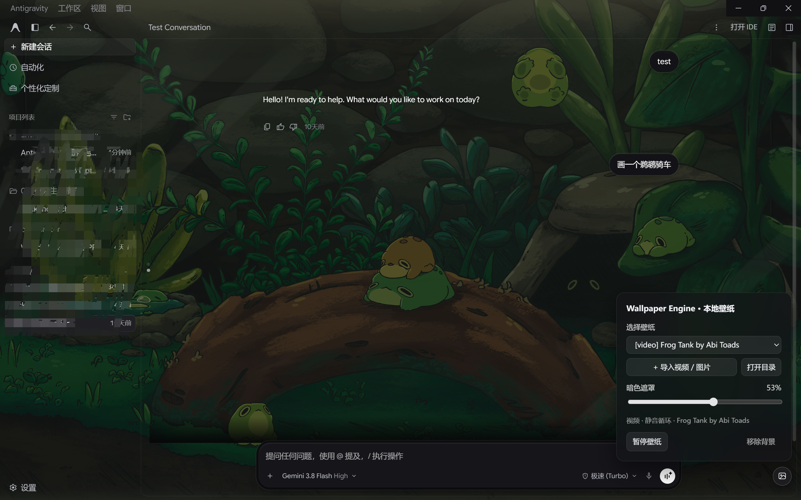

# Antigravity Wallpaper

在 Antigravity 中显示本机 **Wallpaper Engine** 的视频 / 网页壁纸，或导入自己的本地视频与图片作为动态背景。

纯 Node.js 实现，**零第三方依赖**（无需 `npm install`），不修改客户端安装文件。




## 特性

- **零依赖启动**：仅需 Node.js >= 22，克隆后即可直接运行。
- **自动发现 Steam 壁纸库**：读取 Windows Steam 注册表与 `libraryfolders.vdf`，自动扫描所有库中已下载的 Wallpaper Engine（App ID `431960`）Video / Web 壁纸。
- **本地壁纸导入与管理**：支持直接导入视频（`.mp4`、`.webm`、`.m4v`、`.mov`）和图片（`.jpg`、`.jpeg`、`.png`、`.webp`、`.gif`、`.bmp`），支持在面板内重命名、删除和打开目录。
- **轻量毛玻璃控制面板**：右下角悬浮低透明度圆形图标，鼠标悬停显形；支持调节暗色遮罩、暂停播放、一键移除/恢复背景。
- **无侵入注入**：通过本地 CDP 调试端口实时注入，不改动客户端程序文件，随时可移除。

## 环境要求

- Windows 10 / 11
- [Node.js](https://nodejs.org/) >= 22

## 快速开始

```powershell
git clone https://github.com/liutianba-X/antigravity-wallpaper.git
cd antigravity-wallpaper
```

### 方式一：生成桌面快捷方式（推荐日常使用）

运行一次以下命令，在桌面生成 **Antigravity (Wallpaper)** 快捷方式：

```powershell
npm run shortcut
```

之后**先完全退出已打开的 Antigravity**，再直接双击桌面快捷方式即可：它会自动静默拉起后台壁纸服务（无终端黑框）并带调试端口启动 Antigravity。

如果 Antigravity 安装在非默认路径、需要配合代理，或需要手动指定 Steam / 壁纸库目录，可以在生成快捷方式时传入参数：

```powershell
npm run shortcut -- -Exe "D:\Apps\Antigravity\Antigravity.exe" -Proxy "http://127.0.0.1:7890" -Steam "D:\Steam" -Library "E:\SteamLibrary"
```

### 方式二：命令行直接启动

先从菜单/托盘完全退出 Antigravity，再运行：

```powershell
npm start -- --launch
```

如果客户端安装在其他路径：

```powershell
npm start -- --launch --exe "D:\Apps\Antigravity\Antigravity.exe"
```

### 浏览器预览模式（不注入客户端）

```powershell
npm run preview
```

在浏览器打开 <http://127.0.0.1:32190> 即可预览壁纸和控制面板，按 `Ctrl+C` 停止。

## 使用说明

点击右下角圆形毛玻璃图标打开设置面板（点击面板外部或按 `Esc` 收起）：

- **切换壁纸**：在 Steam Workshop 的 Video / Web 壁纸和自定义壁纸之间切换，选择会自动保存并在下次启动时恢复。
- **暗色遮罩**：拖动滑杆调节背景暗度（0% ~ 95%），保证文字清晰可读。
- **导入 / 管理自定义壁纸**：点击「+ 导入视频 / 图片」选择本地文件，导入的文件存放在项目 `.local/custom` 目录中；选中自定义壁纸后可重命名或删除（不会影响 Steam Workshop 原文件）。
- **暂停 / 移除背景**：支持随时暂停视频播放，或一键移除/恢复背景层。

> 视频默认静音循环。Web 壁纸运行在隔离 `iframe` 中，依赖 Wallpaper Engine 专用音频或属性 API 的部分网页壁纸可能无法完整运行。Scene 与 Application 类型暂未接入。

## Steam 壁纸库配置

查看自动扫描到的壁纸列表：

```powershell
npm run list
```

如果 Steam 安装目录或额外游戏库未被自动识别，可以手动指定（`--library` 可重复传入）：

```powershell
npm start -- --steam "D:\Steam"
npm start -- --library "E:\SteamLibrary"
npm start -- --library "E:\SteamLibrary\steamapps\workshop\content\431960"
```

## 原理与安全说明

- 本地壁纸服务仅监听 `127.0.0.1`（默认端口 `32190`），不会暴露到局域网或公网。
- 快捷方式与 `--launch` 会为 Antigravity 启用本机 CDP 调试端口（`--remote-debugging-port=9222 --remote-debugging-address=127.0.0.1`），用于向页面注入背景层与控制面板。
- 请注意：开启本机调试端口后，本机其他进程也可以访问 `127.0.0.1:9222`。如不再使用，直接以普通方式启动 Antigravity 即可恢复原状。

## 故障排查

访问 <http://127.0.0.1:32190/api/status> 查看服务状态；`connection.state` 为 `connected` 表示已成功连接到 Antigravity。

- **无法打开状态页或视频报错**：检查 `.local/service-error.log`，确认后台服务正在运行且 `32190` 端口未被占用。
- **状态一直显示 `waiting`**：从系统托盘完全退出 Antigravity，再通过桌面快捷方式或 `npm start -- --launch` 重新打开。
- **壁纸列表为空**：运行 `npm run list` 检查扫描结果，或用 `--library` 指定 Steam 库目录，也可以直接导入本地视频/图片。

## 开发与测试

```powershell
npm test
```

## License

[MIT](./LICENSE)
